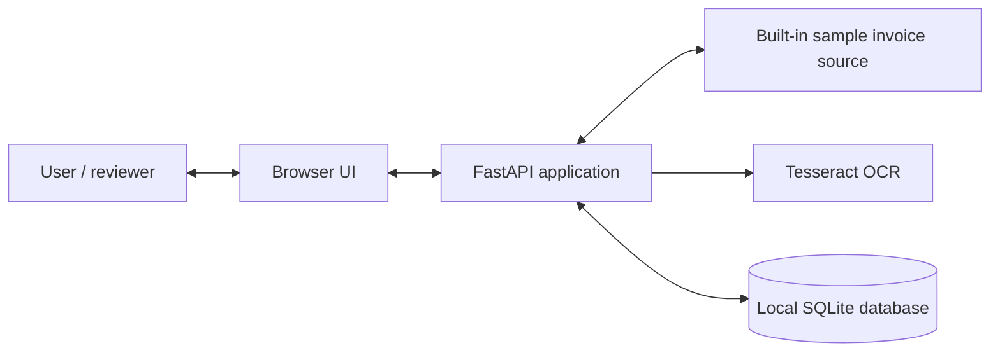
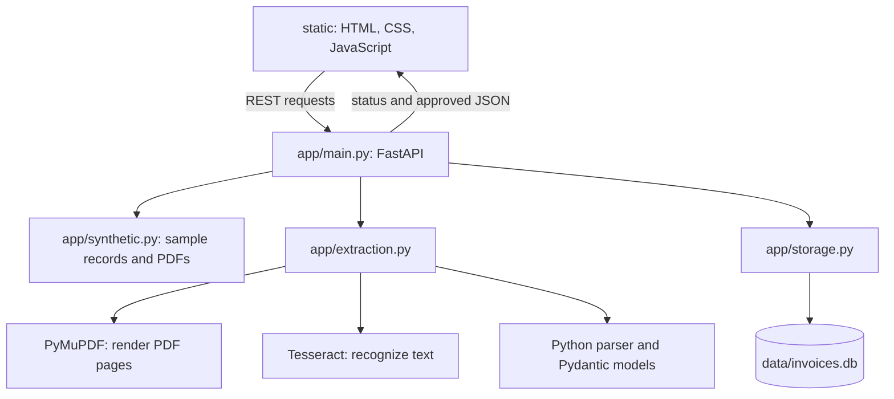

# Project Architecture

## 1. Overview and goals

### System summary

Invoice Management turns an invoice document into structured JSON containing the vendor, invoice number, vendor state, and line items. It reduces manual copying by using OCR for a first pass, while requiring a person to review and approve the result before it is returned.

### Project scope

**Included**

- Fetch and display three synthetic Indian sample invoices.
- Preview a selected invoice PDF and start OCR when requested.
- Extract and let a user edit invoice details and multiple line items.
- Validate and save the review decision.
- Display the approved JSON and retrieve it through the app's result endpoint.
- Reset local workflow state when the page loads or refreshes.

**Not included**

- A live invoice source or external destination system.
- Sending approved JSON to an ERP, accounting platform, or other service. “Send JSON” currently returns the approved result from this app.
- User login, roles, or multi-user access.
- Guaranteed extraction accuracy across arbitrary invoice layouts.
- Production hosting, high availability, monitoring, or scaling.

### Glossary

| Term | Meaning |
|---|---|
| OCR | Optical Character Recognition: converting text in an image or scanned document into machine-readable text. |
| Tesseract | The local OCR engine used to recognize invoice text. |
| Draft | The fields parsed from OCR, before the human reviewer approves them. |
| Line item | One material or service on an invoice, with description, quantity, and unit price. |
| Source invoice | The original invoice record and its document, before OCR processing. |
| Approved JSON | The corrected invoice data returned only after a reviewer approves it. |

## 2. Requirements and constraints

### Key functional flow

1. The browser loads and asks the app to clear its previous workflow state.
2. The user clicks **Fetch invoices**; the app lists the available samples.
3. The user selects an invoice and clicks **Run OCR**.
4. The app reads the document, shows progress, and presents an editable draft.
5. The user reviews the original invoice and corrects any incorrect fields or line items.
6. The user approves the draft; the app stores the approved values and displays JSON.
7. **Send JSON** retrieves that approved result from the app.

### Quality targets (NFRs)

This is a local assignment prototype, not a production service. Specific latency, uptime, concurrency, and data-volume targets have **not** been set or benchmarked. The current design assumes one local user and three sample invoices; OCR time depends on the local computer and document.

| Area | Current target or status |
|---|---|
| Users | One local user; simultaneous-user behavior is not supported. |
| Data volume | Three built-in sample records; no production volume target. |
| Processing time | Progress is shown, but no maximum OCR duration is guaranteed. |
| Availability | Runs as a local Uvicorn process; no uptime SLA. |
| Reliability | Validation and OCR errors are returned to the user; no durable job retry system. |
| Data retention | SQLite stores data during the workflow; page refresh clears all invoice records. |

### Constraints

- Python 3.10 or later and a separately installed Tesseract executable are required.
- Default inputs are locally generated Indian invoice PDFs; no external API key is needed.
- Supported document types are PDF, PNG, JPEG, TIFF, and BMP.
- Documents are limited to 20 MB; PDFs are limited to 20 pages.
- Remote document URLs require HTTPS and an allowed host; insecure HTTP is only configurable for a trusted test setup.
- No budget, delivery deadline, formal compliance certification, or production hosting environment has been specified.
- The app has no user authentication and should remain local for this assignment.

## 3. System architecture and diagrams

### Context diagram

The user interacts with the browser. The browser talks to the FastAPI application. In the assignment configuration, the invoice source is a sample endpoint hosted by the same app; the OCR engine and database are local dependencies, not third-party services.



### Component diagram



### Sequence: fetch, OCR, review, approve, return

```mermaid
sequenceDiagram
    actor Reviewer
    participant UI as Browser UI
    participant API as FastAPI
    participant Source as Sample invoice source
    participant OCR as PyMuPDF and Tesseract
    participant DB as SQLite

    UI->>API: POST /api/reset (page load)
    API->>DB: Clear invoice rows
    Reviewer->>UI: Click Fetch invoices
    UI->>API: GET /api/source-invoices
    API->>Source: GET sample invoice records
    Source-->>API: IDs and PDF URLs
    API-->>UI: Available invoice list
    Reviewer->>UI: Select invoice and click Run OCR
    UI->>API: POST /api/source-invoices/{id}/process
    API->>Source: Retrieve selected PDF
    Source-->>API: PDF bytes
    API->>OCR: Render pages and recognize text
    OCR-->>API: Recognized text
    API->>DB: Save draft as needs_review
    API-->>UI: OCR job status and draft
    Reviewer->>UI: Correct fields and approve
    UI->>API: POST /api/invoices/{id}/approve
    API->>DB: Save reviewed values as approved
    API-->>UI: Approval response; display JSON
    Reviewer->>UI: Click Send JSON
    UI->>API: GET /api/invoices/{id}/result
    API->>DB: Read approved record
    API-->>UI: Approved JSON
```

### Main building blocks

| File or folder | Responsibility |
|---|---|
| `app/main.py` | Web routes, source retrieval, OCR job coordination, reset, review and result endpoints. |
| `app/synthetic.py` | Three synthetic Indian invoices and generated PDFs. |
| `app/extraction.py` | PDF/image OCR, text parsing, and Pydantic data models. |
| `app/storage.py` | SQLite schema and operations for saving and reviewing invoice drafts. |
| `static/` | Browser page, styles, and workflow JavaScript. |
| `tests/` | Automated API, OCR/parser, and storage tests. |

## 4. Technology stack and data design

### Technology choices

| Technology | Use |
|---|---|
| Python | Backend logic, parsing, and OCR workflow. |
| FastAPI | REST endpoints, frontend serving, request validation, and OpenAPI generation. |
| Uvicorn | Local ASGI server used to run FastAPI. |
| HTML, CSS, JavaScript | Lightweight browser interface; no frontend framework is required. |
| Tesseract and `pytesseract` | Local OCR engine and its Python interface. |
| PyMuPDF | Generate sample PDFs and render PDF pages into images for OCR. |
| Pillow | Read and prepare raster image inputs for OCR. |
| Pydantic | Define invoice data and validate item values and approval requests. |
| SQLite and Python `sqlite3` | Persist invoice drafts and approval status without a separate database server. |
| HTTPX | Make HTTP requests to source records and invoice document URLs. |
| `python-dotenv` | Load local settings from `.env`. |
| Python `unittest` | Run the automated tests. |

Python package versions/ranges are listed in `requirements.txt`. Tesseract itself is a separately installed program and is not installed by pip.

### Data model

The SQLite database has one table, `invoices`:

| Column | Meaning |
|---|---|
| `id` | Generated invoice record ID; primary key. |
| `source_id` | ID of the source invoice. |
| `status` | `needs_review`, `approved`, or `rejected`. |
| `draft_json` | Invoice fields and line items, serialized as JSON text. |
| `raw_text` | Text recognized by OCR. |
| `created_at` | Record creation time. |

Line items are embedded in `draft_json`; there is no separate line-item table or separate source table.

```text
invoices
  id (primary key)
  source_id
  status
  draft_json  -> vendor, invoice number, state, items[]
  raw_text
  created_at
```

The public result shape is:

```json
{
  "vendor_name": "Aarav Industrial Supplies",
  "invoice_no": "AIS/2026-27/113",
  "invoice_state": "Gujarat",
  "items": [
    {
      "material_description": "Stainless steel fasteners, assorted M8-M12",
      "quantity": 4.5,
      "price": 1250.0
    }
  ]
}
```

`quantity` and `price` are numeric. `price` is a unit price in INR; currency is not a separate field. There is no cache.

### API and integration specifications

The app uses JSON over REST/HTTP between the browser and FastAPI. FastAPI serves its OpenAPI/Swagger documentation at `http://127.0.0.1:8000/docs` while the local server is running.

| Endpoint | Purpose |
|---|---|
| `GET /api/source-invoices` | Fetches and lists source invoice records. |
| `GET /api/source-invoices/{source_id}/preview` | Serves the original invoice for browser preview. |
| `POST /api/source-invoices/{source_id}/process` | Starts OCR for a selected invoice. |
| `GET /api/jobs/{job_id}` | Returns in-memory OCR progress and outcome. |
| `GET /api/invoices/{id}` | Returns the stored draft and raw OCR text. |
| `POST /api/invoices/{id}/approve` | Validates and stores reviewer-approved data. |
| `POST /api/invoices/{id}/reject` | Rejects a pending draft. |
| `GET /api/invoices/{id}/result` | Returns JSON only when the invoice is approved. |
| `POST /api/reset` | Clears all saved invoices and in-memory workflow state. |

The default sample provider and generated PDF routes are `/sample-api/invoices` and `/sample-api/files/{invoice_id}.pdf`. There is no external downstream integration in the current workflow.

## 5. Infrastructure and deployment

### Hosting and network

- **Current environment:** developer's computer, accessed at `http://127.0.0.1:8000`.
- **Server:** Uvicorn runs FastAPI locally.
- **Database:** local SQLite file at `data/invoices.db` by default.
- **External cloud resources:** none required for sample mode.
- **Network boundary:** local loopback is the intended run mode. The app has no login, so it should not be exposed to a public or untrusted network.

### Environments and CI/CD

There are no defined development/staging/production environments and no CI/CD pipeline. For this assignment, dependencies are installed in a local virtual environment, the app is run with Uvicorn, and tests are run manually with `python -m unittest discover -v`. `.env`, `.venv/`, Python caches, and the database are excluded from Git.

### Monitoring and recovery

- There is no external monitoring, alerting, centralized log collection, backup process, or disaster-recovery plan.
- Errors from API fetch, document retrieval, OCR, and validation are surfaced in the app or HTTP response.
- OCR job state is held in memory; a server restart loses active job information.
- SQLite is not backed up automatically. Page refresh calls the global reset endpoint and deletes saved invoice rows.

These are not defined production SLAs; the application is a local assignment prototype.

## 6. Security and decisions

### Security controls and gaps

**Currently present**

- Remote invoice file URLs are restricted to HTTPS unless the explicit local/test HTTP setting is enabled.
- Document hosts are checked against the configured allowed hosts.
- Download size is limited to 20 MB, and PDFs are limited to 20 pages.
- Pydantic rejects unexpected approval fields and validates invoice item values.
- `.env`, the virtual environment, and local database are ignored by Git.

**Not implemented**

- User authentication, roles, and authorization.
- Encryption at rest for the SQLite database.
- Production secret management, key rotation, or a formal compliance program.
- Tenant/user isolation. `POST /api/reset` clears the shared database.
- External JSON delivery or downstream acknowledgement.

Only synthetic sample data should be used in the current local setup. No GDPR or other regulatory requirements have been specified; compliance should not be assumed.

### Architecture decision records

| Decision | Reason and trade-off |
|---|---|
| Use synthetic invoices by default | Keeps the assignment demonstrable without live data, credentials, or an external provider. The trade-off is that production source integration is not exercised. |
| Use local Tesseract | Avoids a paid/cloud OCR dependency and keeps documents local. The trade-off is that accuracy and speed depend on document quality and the developer's machine. |
| Use deterministic parsing and Pydantic | Makes the sample extraction rules explicit and validates the output. The trade-off is that unfamiliar invoice layouts may not parse correctly. |
| Use SQLite | Simple setup for a local single-user workflow. The trade-off is limited suitability for concurrent users and server-scale workloads. |
| Require human approval before returning a result | OCR is fallible; the reviewer provides a quality check before JSON is treated as final. |
| Clear data on page load/refresh | Provides a fresh assignment run. The trade-off is destructive shared reset behavior, so it is unsuitable for multiple users. |

### Known risks

- OCR can misread fields or miss line items; manual checking remains necessary.
- The parser assumes sample-like invoice layouts and may need redesign for varied real documents.
- A page refresh deletes all saved invoice records, not just the current browser's data.
- In-memory job tracking is lost on restart and does not support multiple server workers reliably.
- There is no user access control, durable backup, production alerting, or configured external destination.
- The current workflow is intentionally scoped for local demonstration, not production processing.
